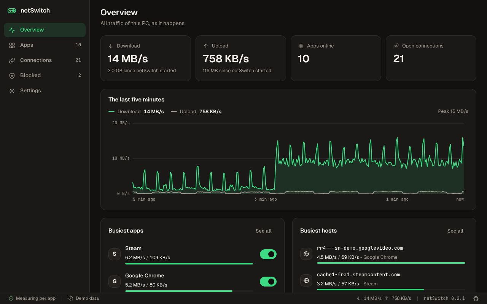
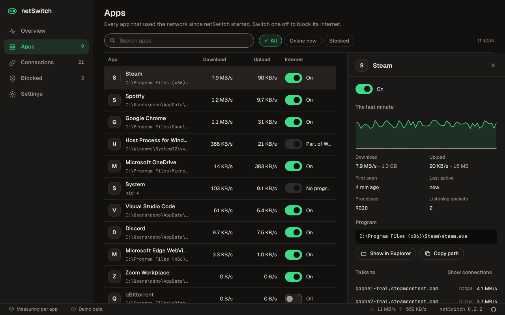
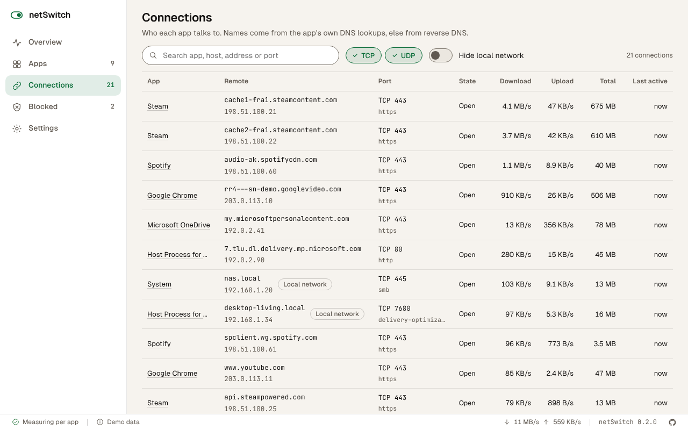

# netSwitch


See which apps use your network, how much and with whom, and switch any of them off.

netSwitch is a Windows app that measures the traffic of every app on the PC, live, lists the hosts
each one talks to, and blocks an app's internet with one switch, using Windows Firewall rules.

<br clear="left">

> **Not fully tested yet.** Version 0.2.0 builds, and its tests pass, on GitHub's Windows runners,
> including the ones that read real traffic and add real firewall rules there. It has not yet been
> used day to day on a real PC. Tell me in an issue if something looks wrong.



## What it does

- **Traffic per app.** Download and upload speed of each app right now, what it moved since
  netSwitch started, and a chart of the last minute. The overview charts the whole PC over the last
  five minutes and ranks the busiest apps and hosts.
- **Connections.** Every TCP and UDP connection, with the app, the host name, the port and its
  service, the state and the traffic. Filter by protocol, hide the local network, or search.
- **An internet switch for each app.** Switching an app off adds two Windows Firewall rules for
  its program, inbound and outbound. It asks first, and switching on removes them again.
- **Blocked apps.** Everything blocked by netSwitch,
  [AppIntBlocker](https://github.com/bugragungoz/AppIntBlocker) or
  [AppIntBlockerGUI](https://github.com/bugragungoz/AppIntBlockerGUI): the three use the same rule
  names, so a block made with one shows up in the others and can be lifted from any of them.
- **New apps.** A Windows notification when an app reaches the internet for the first time while
  netSwitch runs.
- **Safety.** A backup of the whole firewall before the first change of each day, a button for a
  backup at any time, and programs inside the Windows folder (such as `svchost.exe`, which carries
  traffic for many services) cannot be switched off.
- English and Turkish, light and dark theme, speeds in bytes or bits.





## Download

You need Windows 10 or 11 and an administrator account. netSwitch asks for administrator rights
when it starts: reading traffic per app and changing firewall rules both need them.

1. Download `netSwitch_<version>_x64-setup.exe` (or the `.msi`) from
   [Releases](https://github.com/bugragungoz/netswitch/releases).
2. Run it. The installer is not signed, so Windows SmartScreen may warn about it first: choose
   **More info**, then **Run anyway**.

Every build on the [Actions](https://github.com/bugragungoz/netswitch/actions) page also has both
installers attached as an artifact.

## How it works

- **Traffic** comes from Windows itself, through Event Tracing for Windows: the
  `Microsoft-Windows-Kernel-Network` provider reports every TCP and UDP send and receive with the
  process and both addresses. No driver or packet capture is installed. If the trace cannot start,
  netSwitch says so and shows the adapters' totals and the open connections only.
- **Host names** come from the app's own DNS lookups (the `Microsoft-Windows-DNS-Client`
  provider), so a connection shows the name the app asked for. Addresses without one are looked up
  with reverse DNS, which asks your DNS server.
- **Connections** come from the TCP and UDP tables of the IP Helper API, which also say which
  process owns each one, and the **adapter totals** from the counters of the physical adapters.
- **Blocking** uses the Windows Firewall API. Rules are named like AppIntBlocker names them:
  `AppBlocker Rule -<app> - <file> (Inbound)` and `(Outbound)`. A rule matches the program that
  opens a connection, so an app that goes online through another program (an updater, a browser it
  opens) needs that program blocked too.
- Backups are saved in `Documents\netSwitch\Backups`. To restore one, run this as administrator
  with the path of your backup. It replaces all current firewall rules with the backed-up ones:

  ```powershell
  netsh advfirewall import "C:\Users\you\Documents\netSwitch\Backups\FirewallBackup-20261016-101500.wfw"
  ```

Nothing leaves the PC except those reverse DNS lookups. Settings are kept in
`%APPDATA%\com.croxz.netswitch`.

## Build it yourself

You need [Node.js](https://nodejs.org) 22, [Rust](https://rustup.rs) and, on Windows, the
[Tauri prerequisites](https://tauri.app/start/prerequisites/).

```bash
npm ci                 # install
npm run dev            # the app, with live reload
npm run dev:web        # the interface alone in a browser, with made-up data
npm run verify         # versions, locales, lint, colors, types and unit tests
cargo test --workspace # the Rust core and shell
npm run test:ui        # the built interface in Chromium
npm run shots          # the screenshots above
npm run icons          # the Windows icons from docs/design/icon.svg
npm run build          # the installers (on Windows)
```

The system tests in `crates/netswitch-core/tests/windows_system.rs` read real traffic and add and
remove firewall rules for a program that does not exist. They run in CI; to run them yourself, use
an administrator terminal on Windows:
`cargo test -p netswitch-core --test windows_system -- --include-ignored --test-threads 1`.

The project is a Rust core that turns the system's reports into numbers (`crates/netswitch-core`),
a [Tauri](https://tauri.app) shell (`src-tauri`) and a [Preact](https://preactjs.com) interface on
the Bugra design system (`src`, see [docs/design/ADDED.md](docs/design/ADDED.md)).

## Credits

- [Sniffnet](https://github.com/GyulyVGC/sniffnet) gave the idea for several features: traffic per
  app, host names, the busiest hosts and notifications. netSwitch shares no code with it.
- [Geist](https://vercel.com/font) and [JetBrains Mono](https://www.jetbrains.com/lp/mono/), both
  under the SIL Open Font License.
- The GitHub mark is from [Primer Octicons](https://github.com/primer/octicons) (MIT).
- [ferrisetw](https://github.com/n4r1b/ferrisetw) for the event traces and the
  [windows](https://github.com/microsoft/windows-rs) crate for the system APIs.

## License

[MIT](LICENSE)

The first version was developed with assistance from AI models: Claude Opus 4.5 and Gemini 3 Pro.

It was later rebuilt with Claude Opus 5.5.
